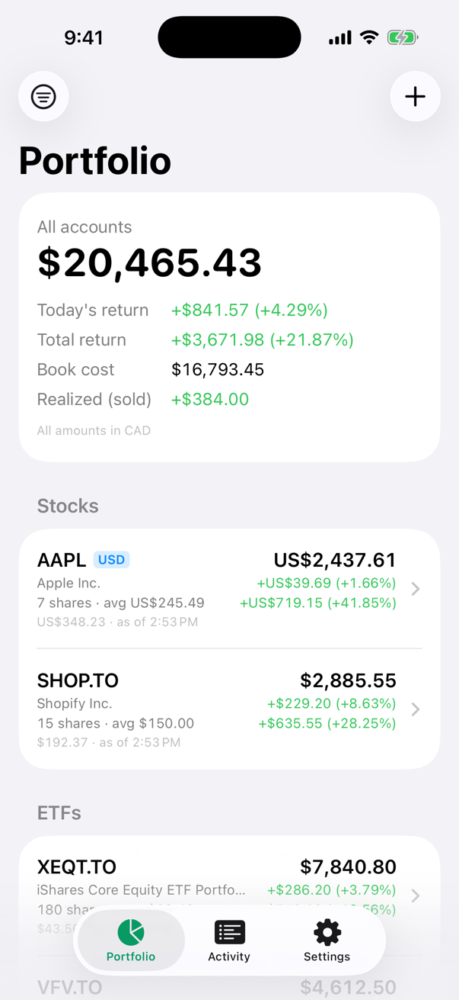
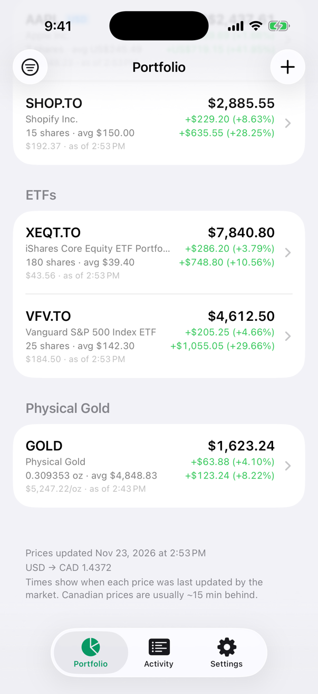
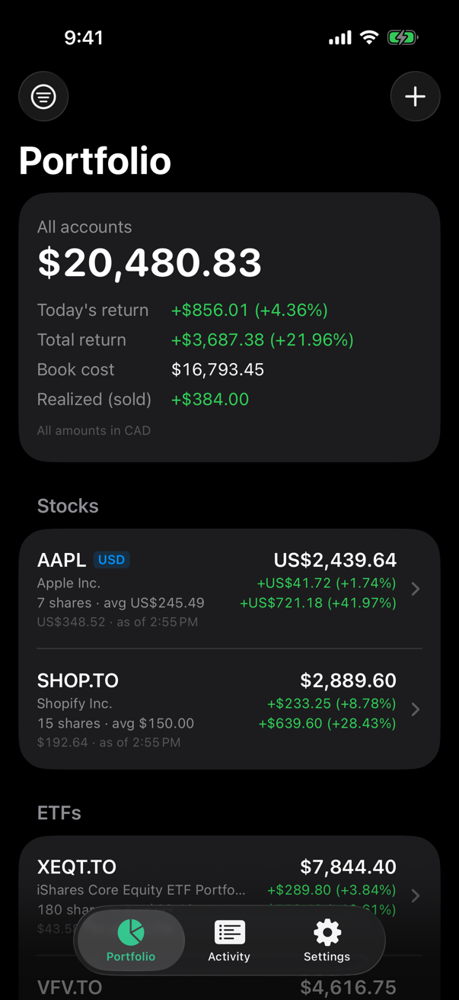
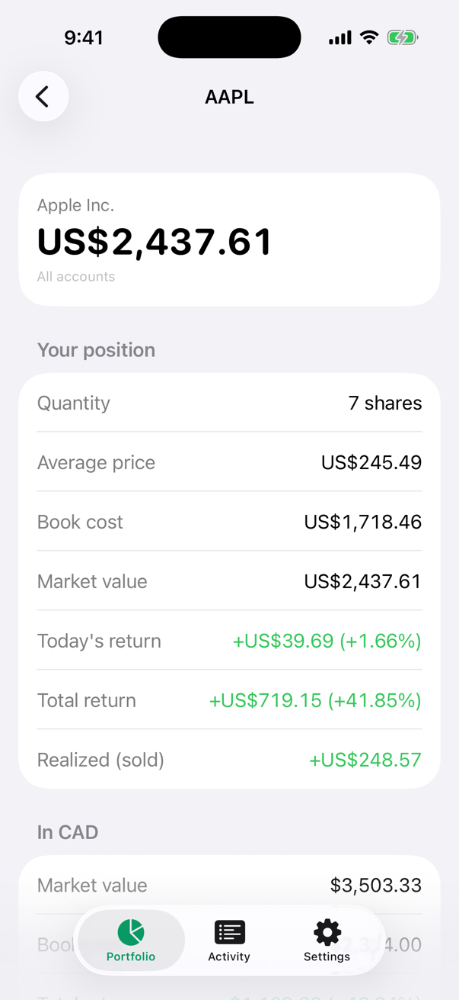
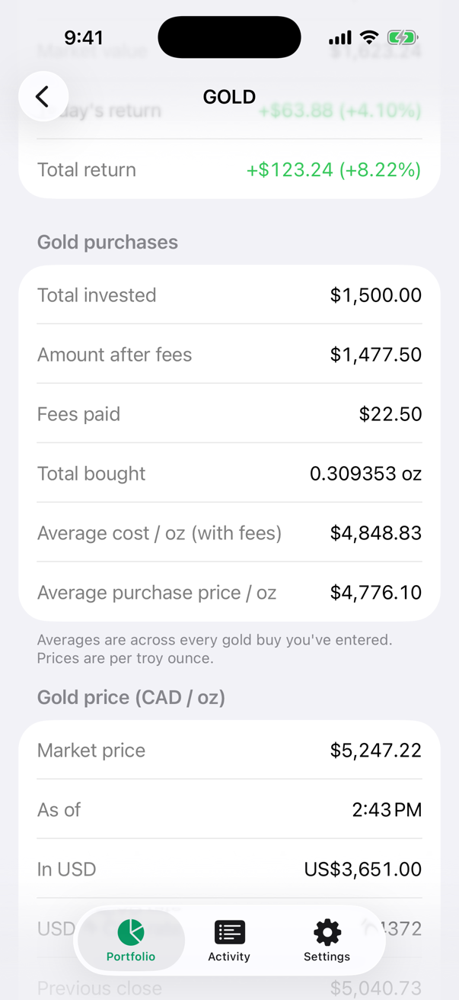
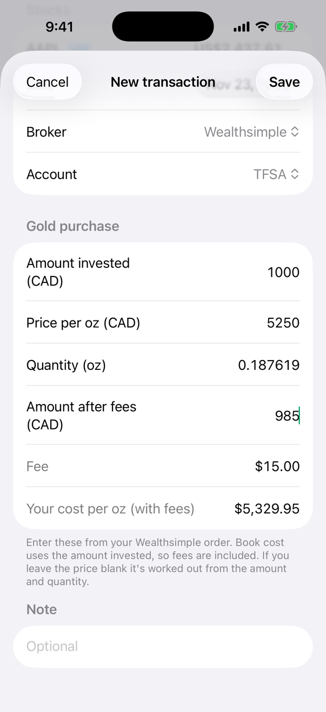
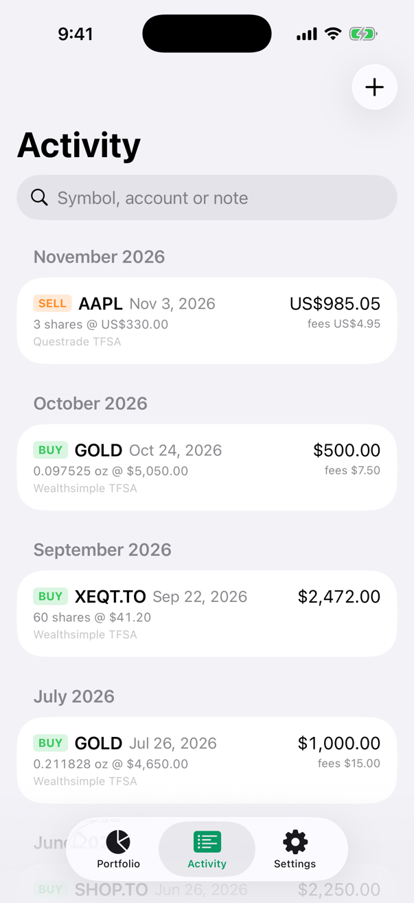
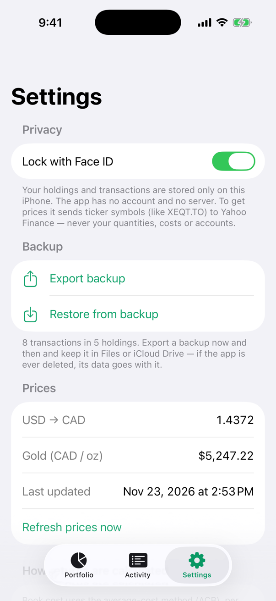

# Investment Tracker

A private iPhone app for tracking investments from **Wealthsimple** and **Questrade** in one place: stocks, ETFs, index funds and physical gold. You enter your own trades; the app pulls live prices and shows your book cost, average price, today's return and total return. Once installed, it appears on your home screen as **Portfolio**.

No account, no server, no bank logins. **Your trades are stored only on your iPhone.**

  
  &nbsp;&nbsp;
  
  &nbsp;&nbsp;
  

> All screenshots use made-up demo data.

## Why
Wealthsimple and Questrade each show only their own accounts, and Google Finance can't add Wealthsimple's physical gold. This app puts everything in one list, in CAD, without handing your data to anyone.

## Features
| | |
|---|---|
| **One portfolio** | Every account from both brokers in one list, or filter to a broker or a single account (TFSA, RRSP, FHSA, non-registered) |
| **The numbers that matter** | Book cost, average price, market value, today's return and total return, per holding and for the whole portfolio |
| **Live prices** | Canadian (`.TO`) and US stocks and ETFs, gold, and USD → CAD, each shown with the time of the price |
| **Physical gold** | Enter amount invested, price per oz, quantity and amount after fees; see totals, fees and your averages |
| **USD holdings** | Shown in USD, converted to CAD in totals. Optionally record the CAD you actually paid so book cost matches your broker |
| **Sells** | Average-cost (ACB) method per account, the way Canadian brokers report it, with realized gains |
| **Your own price** | Override any price, such as Wealthsimple's gold price or a mutual fund's daily price |
| **Private** | Face ID lock, data stored only on the device, JSON backup and restore |

## Screens

| Holding | Physical gold | Adding gold |
|---|---|---|
|  |  |  |

| Activity | Settings |
|---|---|
|  |  |

## How the numbers work
| Number | How it's worked out |
|---|---|
| **Book cost** | What you paid, including fees. When you sell, it goes down by the sold shares' share of the average cost |
| **Average price** | Book cost ÷ shares (or ounces) you still hold |
| **Market value** | Shares × latest price |
| **Today's return** | Shares held since yesterday × (price − yesterday's close), plus anything bought today × (price − your purchase price) |
| **Total return** | Market value − book cost (on what you still hold) |
| **Realized** | Money from sales − the average cost of the shares you sold |

Each account keeps its own average cost, like your broker does. USD holdings show in USD on their own page and convert to CAD in the totals.

### Gold
Gold is valued per **troy ounce in CAD**: the COMEX gold price in USD × the live USD → CAD rate. Wealthsimple adds its own spread, so its price will differ slightly. Turn on **Use my own price** on the gold page to type Wealthsimple's price instead.

For each gold purchase you enter what's on your Wealthsimple order:

| Field | Example |
|---|---|
| Amount invested (CAD) | 1,000.00 |
| Price per oz (CAD) | 5,250.00 |
| Quantity (oz) | 0.187619 |
| Amount after fees (CAD) | 985.00 |

The gold page then shows total invested, total after fees, fees paid, average cost per oz (with fees) and average purchase price per oz, across all your purchases.

### Prices
Prices come from Yahoo Finance's public quote service. Only **ticker symbols** are sent (for example `XEQT.TO`), never your quantities, costs or accounts. Prices refresh when you open the app or pull down to refresh.

| Type | Typical delay |
|---|---|
| US stocks and ETFs | Near real-time |
| Canadian stocks and ETFs (`.TO`) | ~15 minutes |
| Gold (COMEX) | ~10 minutes |
| Mutual-fund index funds | One price per day, after the close |

If a price can't be loaded, the app uses the last saved price, then your own price, then your last trade price.

## Using the app
1. **Add a trade:** tap **+**, pick Stock / ETF / Index Fund / Gold, then search a name or ticker (`XEQT`, `Apple`…). Canadian listings end in `.TO`.
2. **Fill in the details:** Buy or Sell, date, broker, account, shares, price and fees. *Total paid* is optional and is worked out for you.
3. **See a holding:** tap it for its numbers, a per-account breakdown, the price and its time, and every transaction.
4. **Edit or delete:** tap a transaction to edit it, or swipe left to delete it (also from the **Activity** tab).
5. **Filter:** use the button at the top left of **Portfolio** to show one broker or account.
6. **Back up:** **Settings → Export backup** saves a JSON file to Files or iCloud Drive. **Restore from backup** brings it back.

## Install on your iPhone
This isn't on the App Store. You build it onto your own phone with Xcode, which is free.

**You need:** a Mac with [Xcode](https://apps.apple.com/app/xcode/id497799835), an iPhone (iOS 17 or later), a USB cable and an Apple ID.

1. **Get the code:** click the green **Code** button above → **Download ZIP** and unzip it (or `git clone` it).
2. **Sign in to Xcode:** open **Xcode → Settings → Accounts**, click **+** and add your Apple ID. A free account works.
3. **Add your Team ID:**
   - In `Portfolio/Config/`, copy `Signing.local.xcconfig.example` to `Signing.local.xcconfig`.
   - Replace `YOUR_TEAM_ID` with your Team ID. You'll find it in Xcode → Settings → Accounts → your Apple ID → Team.
   - This file is git-ignored, so your Team ID is never committed.
4. **Open the project:** double-click `Portfolio/Portfolio.xcodeproj`.
5. **Give the app your own ID:** click the blue **Portfolio** project → target **Portfolio** → **Signing & Capabilities**, and change the bundle identifier `com.private.portfoliotracker.k7q2` to something unique, e.g. `com.yourname.portfolio`.
6. **Connect your iPhone:** plug it in, unlock it and tap **Trust**. Then on the phone, turn on **Settings → Privacy & Security → Developer Mode** and restart when asked.
7. **Run:** pick your iPhone from the device menu at the top of Xcode and press **▶ Run** (⌘R). Keep the phone unlocked while it installs.
8. **Trust the app (first time only):** on the phone, go to **Settings → General → VPN & Device Management** → your Apple ID → **Trust**. Then open **Portfolio**.

> **Free Apple ID:** the app runs for 7 days, then stops opening. Plug the phone in and press **▶ Run** again; your data is kept. A paid Apple Developer account ($99 USD/year) extends this to a year.

### Try it with demo data
To see the app filled in (in the simulator or on a phone):
1. In Xcode, open **Product → Scheme → Edit Scheme… → Run → Arguments**.
2. Add `-demo` under *Arguments Passed On Launch*, then run.

This **replaces everything in the app** with a sample portfolio, so only use it on a simulator or a phone without real data. Remove the argument afterwards. Demo mode only exists in Debug builds.

## Project structure
| Path | What it is |
|---|---|
| `Portfolio/Portfolio/Models.swift` | Stored data: holdings and trades (SwiftData) |
| `Portfolio/Portfolio/Calculations.swift` | Book cost, averages, today's and total return, realized gains |
| `Portfolio/Portfolio/PriceService.swift` | Live prices, gold in CAD, USD → CAD, ticker search |
| `Portfolio/Portfolio/Views/` | Screens: Portfolio, holding detail, add/edit trade, Activity, Settings |
| `Portfolio/Portfolio/Backup.swift` | JSON export and restore |
| `Portfolio/Portfolio/DemoData.swift` | Sample portfolio for `-demo` (Debug builds only) |
| `Portfolio/Config/` | Signing settings; your Team ID goes in the git-ignored `Signing.local.xcconfig` |

Built with SwiftUI and SwiftData, iOS 17+. No third-party dependencies.

## Notes
- Yahoo Finance's quote service is unofficial and could change without notice. If prices stop loading, the app keeps working with your own prices.
- This is a personal tracking tool, not financial or tax advice. Check your broker's statements for official figures.

## License
MIT — see [LICENSE](LICENSE).
